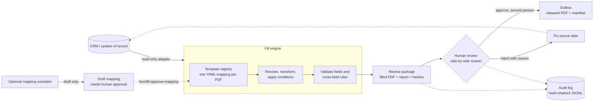

# form-fill-engine

**Fill partner and provider PDF forms from client records, with validation, a human approval gate and a tamper-evident audit trail.**

Built for back offices in regulated businesses (insurance brokers, wealth managers, accounting firms) where staff re-type the same client data into other organisations' PDF forms all day.

 

## The business problem

A client changes beneficiaries, sets up a monthly contribution, or moves country. The data is already in the CRM. Yet someone still opens the partner's PDF, reads the client file on a second screen and re-types name, date of birth, policy number, IBAN and tax details, box by box. Then a colleague checks it, it goes out, and sometimes it comes back rejected because one digit was wrong.

That work has three costs, and all of them scale with volume:

| Cost | Where it comes from | What this project does about it |
| --- | --- | --- |
| **Time** | Minutes of copy-typing per form, multiplied by every form, every client event, every partner | Fills every mapped box from the record in one step |
| **Errors** | A transposed IBAN digit, a stale identity check, shares that add up to 90 percent, a form returned by the partner and redone | Checks each value before it reaches the PDF and stops the package when something is wrong |
| **Control** | No record of who checked what, or whether the file sent is the file checked | Requires a second person to approve, and logs both decisions with a hash of the exact file |

**A worked cost model, with your numbers.** This repository makes no claim about savings at any real firm. To size the opportunity in yours, measure three things for one month: forms filled (`N`), average minutes per form by hand (`m`), and the share returned or corrected (`r`). Monthly typing time is `N x m / 60` hours, and every returned form costs the cycle again. For example, *if* a team fills 400 forms a month at 12 minutes each, that is 80 hours a month of re-typing before rework is counted. Replace the example values with measured ones before using them in a business case.

**What it is not.** It does not decide anything about a client, never writes back to the CRM, and never sends a form by itself. Software prepares, a person approves, and only approved files are released.

## How it works



1. **Template registry.** Each PDF template has a YAML mapping: PDF field, source path in the client record, transforms, validation rules, required flag and conditions. Only mappings with `status: approved` and a named approver can fill forms.
2. **Data source adapters.** A read-only interface with JSON, CSV and REST (OAuth2 client credentials) implementations. No adapter has a write method; the REST adapter refuses any verb other than `GET` before a request leaves the process.
3. **Fill engine.** Resolves each value, applies transforms (date formats, amounts, IBAN spacing, code lookups), evaluates conditions, validates, then writes the AcroForm with pypdf: text, checkboxes and radio groups.
4. **Validation and review report.** Every field ends in one of six states: `filled`, `doubtful`, `missing`, `invalid`, `empty`, `skipped`. Missing and invalid values block approval. Doubtful values (a stale identity review, an amount under the provider minimum, a national ID that does not match the configured pattern) are written but flagged for a person.
5. **Human review.** A small FastAPI app shows each field's value as read back from the PDF, next to its source path and source value, with the PDF beside it. Approve or reject. Rejection needs a reason; approval needs a second person.
6. **Release and audit.** Approved packages are copied (or flattened, per template) into `outbox/` with a manifest. Every step is appended to a hash-chained JSONL log with the actor and the SHA-256 of the file.

## Quickstart

Requires Python 3.10 or newer.

```bash
git clone <this repository> form-fill-engine
cd form-fill-engine
python -m venv .venv && source .venv/bin/activate     # Windows: .venv\Scripts\activate
pip install -e ".[dev]"

formfill list-templates
formfill validate --template northwind_beneficiary_change --client CL-1003
formfill fill --template northwind_beneficiary_change --client CL-1001 --prepared-by pat.preparer
formfill serve                                         # http://127.0.0.1:8000
```

Open the review page, enter a reviewer name other than the preparer and approve. The released PDF and its manifest appear under `work/outbox/<package_id>/`. Then:

```bash
formfill verify-audit                                  # OK: 2 entries, chain intact
```

The three sample clients are built to show different outcomes:

| Client | Northwind beneficiary change | Bluepeak SEPA mandate | Harborline tax self-certification |
| --- | --- | --- | --- |
| `CL-1001` | ready | ready | ready |
| `CL-1002` | blocked: shares add up to 90 | blocked: IBAN checksum fails; amount below minimum flagged | ready, foreign TIN filled by condition |
| `CL-1003` | ready with 2 doubtful fields (stale identity review, ID pattern) | blocked: no recorded debit consent | blocked: US person without US taxpayer number |

With Docker:

```bash
docker build -t form-fill-engine .
docker run --rm -p 127.0.0.1:8000:8000 -v "$PWD/work:/app/work" form-fill-engine
docker run --rm -v "$PWD/work:/app/work" form-fill-engine \
  formfill fill --template bluepeak_sepa_mandate --client CL-1001 --prepared-by pat.preparer
```

### CLI reference

| Command | Purpose |
| --- | --- |
| `formfill list-templates` | List mappings, their approval state and whether the PDF exists |
| `formfill validate --template T [--client C] [--json]` | Check a mapping against its PDF; with a client, print the review report. Exits 1 when blocked |
| `formfill fill --template T --client C [--prepared-by NAME]` | Fill the PDF and queue a review package |
| `formfill suggest-mapping FORM.pdf [--provider heuristic\|anthropic\|openai]` | Write a draft mapping for a new PDF. Never applied automatically |
| `formfill approve-mapping DRAFT.yaml --by NAME` | Promote a reviewed draft into the registry and log it |
| `formfill serve [--host] [--port] [--trusted-user-header H]` | Run the review app |
| `formfill verify-audit` | Verify the audit log hash chain |

Global options `--mappings`, `--data` and `--workdir` (or `FORMFILL_MAPPINGS`, `FORMFILL_DATA`, `FORMFILL_WORKDIR`) point at your own directories. `--data` accepts `.json` or `.csv`.

## Adding a template

1. **Put the blank PDF** in a forms directory. It must have AcroForm fields; a scanned image needs a fillable version from the partner first.
2. **Draft the mapping.** Either write it by hand, or ask for a suggestion:

   ```bash
   formfill suggest-mapping forms/new_partner_form.pdf --client CL-1001
   ```

   The draft lands in `mappings/_drafts/` with `status: draft`, a confidence score and rationale per field, and a `todo` on fields with no confident match. The registry ignores the drafts folder, and refuses drafts even when pointed at them directly.
3. **Review every entry.** Fix sources, add transforms and validation, delete the `confidence`, `rationale` and `todo` keys, and remove or map unmatched fields.
4. **Approve it** under your name. Approval fails while any review marker is left, and the file is loaded once more to catch errors:

   ```bash
   formfill approve-mapping mappings/_drafts/new_partner_form.yaml --by ops.lead@example.org
   ```

5. **Check it against the PDF and real records** before the first live fill:

   ```bash
   formfill validate --template new_partner_form
   formfill validate --template new_partner_form --client CL-1001
   ```

### Mapping reference

```yaml
template_id: northwind_beneficiary_change
title: Beneficiary Designation Change
provider: Northwind Assurance (fictional)
version: "3"
pdf: ../forms/northwind_beneficiary_change.pdf   # relative to this file
status: approved                                  # drafts cannot fill forms
approved_by: ops.lead@example.org
flatten: false                                    # true: released copy is not editable

fields:
  - pdf_field: holder_name
    sources: [person.first_name, person.last_name]   # or `source: a.b[0].c`, or `value: constant`
    transform: [join]
    required: true

  - pdf_field: life_cover_amount
    source: contract.life_cover_amount
    when: {path: contract.contract_type, equals: life}  # conditional fill
    transform: [{amount: {places: 2, decimal: ",", thousands: "."}}]
    validate:
      - range: {min: 1000, max: 5000000}

  - pdf_field: contract_type
    type: radio                                       # text (default), checkbox, radio
    source: contract.contract_type
    options: [life, savings]

rules:                                                # cross-field checks
  - {name: shares_total_100, type: sum_equals, paths: ["beneficiaries[0].share", "beneficiaries[1].share"], total: 100}
  - {name: born_before_contract, type: date_order, before: person.birth_date, after: contract.start_date}
```

| Building block | Available |
| --- | --- |
| Transforms | `strip`, `upper`, `lower`, `title`, `digits_only`, `iban_spaced`, `date`, `amount`, `map`, `equals`, `join`, `truncate` |
| Validators | `iban` (mod-97 and country length), `date` (format, `not_future`), `max_age_days`, `regex`, `national_id`, `email`, `one_of`, `range`, `max_length` |
| Conditions | `equals`, `not_equals`, `in`, `not_in`, `exists`, `gt`, `lt`, combined with `all`, `any`, `not` |
| Rules | `sum_equals`, `date_order`, `required_if` |

Each validator takes `severity: error` (blocks) or `severity: warning` (doubtful), and `on: source` or `on: output`. The PDF's own `MaxLen` is checked automatically.

The `national_id` schemes shipped here are **labelled placeholders**. National identifier formats differ by country and must come from your compliance team, not from a library default.

## GDPR, data protection and audit notes

This is a reference implementation, not legal advice. Points designed in, and points you still own:

- **Data minimisation.** The engine reads only the paths a mapping names. The LLM mapping assistant sends PDF field names and record *paths* (for example `banking.iban`), never record values; a test enforces this.
- **Read-only access.** Adapters cannot write to the system of record. Use a CRM service account scoped to read only the fields your templates need.
- **Personal data at rest.** `work/packages/` and `work/outbox/` contain filled forms and review reports, which are personal data. Put the work directory on encrypted storage, restrict access to the back-office team, and apply your retention schedule (delete released packages once the partner confirms receipt and your retention period ends).
- **Audit log content.** Entries hold actors, identifiers, timestamps, summaries and SHA-256 hashes, not field values. The log can be retained longer than the forms without becoming a second copy of client data.
- **Tamper evidence.** Each entry includes the hash of the previous one. `formfill verify-audit` reports the first altered or missing entry. For stronger guarantees, ship the log to write-once storage or anchor the latest hash externally.
- **Accountability.** Approval records who approved, when, which doubtful fields they accepted, the hash of the reviewed file and the hash of the released file. The four-eyes rule stops the preparer approving their own package.
- **Integrity at release.** Approval is refused if the filled PDF, its mapping or the blank template changed after the package was prepared.
- **Declarations stay human.** The sample tax form includes a declaration checkbox that is deliberately left unmapped. A client's own statement should never be ticked by software.
- **Lawful basis and processors.** Filling a partner form is usually part of contract performance, but confirm your basis, and list any LLM provider as a processor before enabling the assistant.

## Design decisions

- **YAML mappings, not code.** Operations staff can read and review a mapping; a diff shows exactly what changed between form versions. The mapping, not the engine, is the unit a person approves.
- **A small fixed vocabulary instead of expressions.** Conditions and rules use a closed set of operators; there is no `eval`. Every mapping is validated at load time, so a typo fails when the file loads, not halfway through a batch.
- **Prepare, then render.** `prepare()` is pure: it resolves, transforms and validates without touching files. That makes `formfill validate` safe to run on live data, and keeps the engine easy to test.
- **Missing is not null.** The path resolver distinguishes a key that does not exist from an explicit empty value, so a renamed CRM field reports as missing rather than silently filling a blank.
- **Doubtful is a first-class state.** Real data is not just valid or invalid. A stale identity review is a judgement call; the tool surfaces it and records the reviewer's decision instead of guessing.
- **The reviewer sees the file, not the intention.** The review screen reads values back out of the generated PDF and flags any difference from the engine's output.
- **Fail loudly on form drift.** Filling a field name that is not in the PDF raises; `validate` reports unmapped PDF fields. A partner's new form version cannot be filled quietly with an old mapping.
- **Flatten at release, not at fill.** The reviewer works on the editable file; the flattened copy is produced from that exact file after approval, and both hashes are recorded.
- **CSV values stay text unless clearly numbers.** Postcodes like `01234` and phone numbers keep their characters.
- **Identity from the platform.** The app accepts a typed reviewer name for local use. Behind a single sign-on proxy, `--trusted-user-header` takes identity from the proxy only.
- **Few dependencies.** pypdf, PyYAML, httpx, FastAPI and Jinja2. LLM providers are called over plain HTTP, so no vendor SDK is required and tests run fully offline with mock transports.

## Deployment notes

- Bind the review app to `127.0.0.1` (the default) unless an authenticating reverse proxy is in front of it. In that setup, run with `--trusted-user-header X-Forwarded-User` (or your proxy's header) and make sure the proxy strips that header from client requests.
- The reference app has no CSRF tokens or role model. Add both, or place it behind a proxy that enforces them, before exposing it beyond a single workstation.
- Credentials for the REST adapter and LLM providers come from the environment or a secret store. Nothing secret belongs in mapping files.

## Project layout

```
src/formfill/
  adapters/        read-only data sources: JSON, CSV, REST with OAuth2 client credentials
  review/          package store, audit log, FastAPI review app and templates
  registry.py      YAML mapping loader and approval gate
  engine.py        prepare (resolve, transform, validate) and render
  pdf.py           pypdf wrapper: inspect, fill, read back, flatten
  transforms.py    value transforms
  validators.py    field validators and cross-field rules
  conditions.py    conditional logic
  mapping_assist.py  draft mapping suggestions: heuristic, Anthropic, OpenAI
  sample_forms.py  generator for the fictional sample PDFs
samples/           fictional forms, mappings and client records (JSON and CSV)
scripts/           generate_sample_forms.py
tests/             offline pytest suite
```

## Development

```bash
pip install -e ".[dev]"
ruff check . && ruff format --check .
pytest
python scripts/generate_sample_forms.py     # rebuild samples/forms
```

## Disclaimer

All organisations, forms, people, identifiers and bank details in this repository are fictional and exist only to demonstrate the software. Any resemblance to real entities is coincidental. IBANs use zero bank codes and valid checksums so they pass validation without pointing at a real account.

## Author

Dr Younes Boujoudar. Released under the [MIT License](LICENSE).
